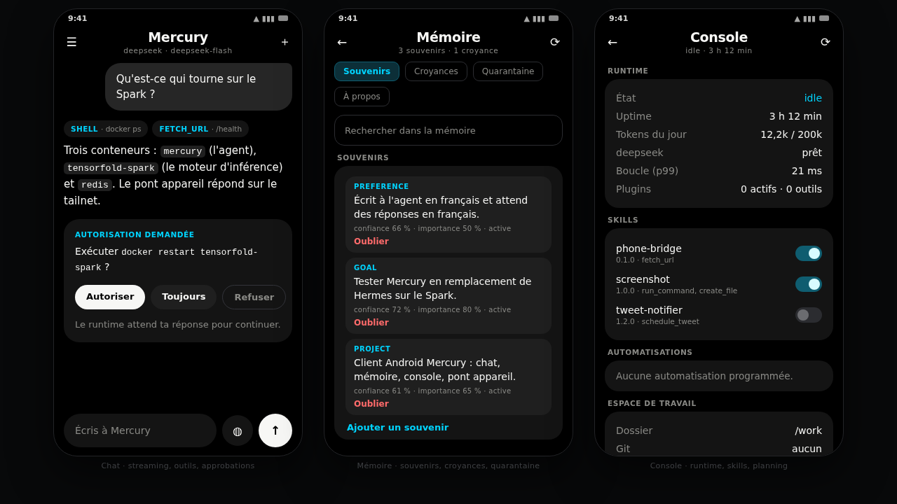

# Mercury Android

An **unofficial Android client for [Mercury Agent](https://github.com/cosmicstack-labs/mercury-agent)**, with an
interface inspired by the Grok app: near-black canvas, one accent colour, big composer, streaming answers,
hold-the-mic dictation, and nothing else in the way.

Not affiliated with Cosmic Stack. It talks to the HTTP API that Mercury's own web dashboard already exposes —
no plugin, no patch, no fork of the agent.

> Status: early. The chat path (login → send → stream → approve) works against Mercury 1.4.2.

## Aperçu



> **Maquette, pas une capture d'appareil.** Cette planche reprend les jetons exacts du thème
> (`ui/theme/Theme.kt` : palette, tailles, rayons) et le contenu réel des écrans, mais elle est
> dessinée hors Android : aucune machine de ce projet ne peut démarrer un émulateur (pas de paquet
> `emulator` pour linux-aarch64, Robolectric refuse aarch64, `redroid` exige `binder_linux`).
> La source est `docs/screenshots/overview.html` ; remplacer l'image par une capture réelle
> (même nom de fichier) est un simple copier-coller.

## What it does

- **Sign in** to your Mercury instance with the dashboard credentials (session cookie, stored encrypted).
- **Stream** answers token by token over Mercury's SSE feed, with tool steps shown as chips above the reply.
- **Approve** permission requests (`yes` / `always` / `no`) from the phone, instead of walking back to the terminal.
- **Browse sessions** in a drawer, resume any of them with its history, or delete one.
- **Answer everything the runtime blocks on**: tool approvals, loop "keep going?", free-form
  choices and the auto-approval prompt — all through the same permission route.
- **Switch model** from a picker built from `/api/chat/models`, rename entries, and flip
  auto-approval without leaving the phone (réglages).
- **Watch the bill**: daily tokens, remaining budget and the per-channel breakdown.
- **Read its memory**: search what it remembers, add a fact by hand, forget one, confirm or correct
  a belief, restore what the brain set aside — and see the identity/budget the runtime runs with.
- **Supervise the daemon** from the console tab: state, uptime, loop lag, providers, bots and
  their queue, background tasks, schedules, agents, skills on/off, plugins, workspace, restart.
- **Dictate** with the system speech recogniser — the text lands in the composer, never auto-sent.
- **Markdown** rendering for what agents actually emit: fenced code, lists, headings, `inline code`, **bold**, *italic*.

## Requirements

1. Mercury running with the web dashboard enabled:
   ```bash
   MERCURY_WEB_ENABLED=true MERCURY_PORT=6174
   ```
   The dashboard binds `127.0.0.1` only, so the phone needs a route to it. Recommended:
   ```bash
   tailscale serve --bg --https=8443 http://127.0.0.1:6174
   # then use https://<host>.<tailnet>.ts.net:8443 in the app
   ```
   An SSH tunnel from the phone (`adb reverse`, Termux `ssh -L`, …) also works.
2. A dashboard user. `docker exec -it mercury mercury web-reset-password` sets the password;
   the username is in `~/.mercury/web-config.json` (usually `mercury`).

## Pont appareil (device bridge)

The app can expose the phone's own data to Mercury, read-only, over the tailnet —
so the agent on the Spark can answer "what's on my agenda tomorrow?" or "who texted
me?" without any server-side plugin.

Toggle **Pont appareil** in the drawer:

- **Calendrier** (`READ_CALENDAR`) — events, `GET /calendar?from=&to=&limit=`
- **Contacts** (`READ_CONTACTS`) — names, numbers, e-mails, `GET /contacts?q=&limit=`
- **SMS** (`READ_SMS`) — inbox, `GET /sms?limit=&address=`
- **Messages d'apps** — notification access, `GET /messages?limit=` (SMS + notifications,
  the only way to see WhatsApp/Signal/Messenger content: Android has no readable store for them)
- **Statut** — battery, network, timezone, `GET /device/status`
- `GET /health` — version, device, active providers (no token)

Security model:

- every route except `/health` requires the bearer token (constant-time compare) in
  `Authorization: Bearer …` — or `?token=` because Mercury's `fetch_url` sends no headers;
- the token is generated on the device, stored in Keystore-backed encrypted prefs, and
  revocable in one tap;
- the socket binds to the Tailscale address when present, 120 requests/minute cap;
- nothing is cached, nothing is written to disk: each request re-reads the provider.

Mercury side: `MERCURY_ALLOW_PRIVATE_FETCH=1` in `mercury.env` (SSRF protection
otherwise blocks private addresses), then copy `mercury-skills/phone-bridge/SKILL.md`
into `~/.mercury/skills/phone-bridge/` and paste the URL + token from the app.

Caveat: `READ_SMS` is a **restricted permission** for Google Play — an app whose core
function is not SMS cannot ship there with it. Sideloading is unaffected. The
notification-based message access has no such restriction.

## Build

JDK 17+ and the Android SDK (compileSdk 35) are required.

```bash
./gradlew testDebugUnitTest   # 6 test classes, no device needed
./gradlew assembleDebug       # app/build/outputs/apk/debug/app-debug.apk
```

A prebuilt debug APK is attached to every release and by CI on `main`.

### Building on an ARM64 host (DGX Spark, arm64 VM)

Google ships `aapt2` for **x86_64 only** — no `linux_arm64` classifier exists on Google Maven, so any Android
build on an arm64 host fails with `Exec format error` (this is language-agnostic: `cargo-apk`/`xbuild` for a
Rust UI would hit the same wall). The repo ships a builder image that runs the official `aapt2` under
`qemu-user` inside a container, so nothing changes on the host:

```bash
./scripts/build-arm64.sh                       # :core:test + :app:assembleDebug
./scripts/build-arm64.sh :app:assembleRelease  # any other Gradle task
```

It builds `docker/Dockerfile.builder` (Android SDK 35 + qemu-user + amd64 `libc`/`libstdc++`), then runs Gradle
with `-Pandroid.aapt2FromMavenOverride=/opt/aapt2-qemu/bin/aapt2`. Expect ~20 s once the image and the Gradle
cache are warm.

## How it works

```
core/src/main/kotlin/io/github/tournierjc/mercury/     (JVM, no Android — unit tested)
├── data/MercuryApi.kt        one typed method per Mercury route
├── data/SseParser.kt         SSE framing, chunk-boundary safe
├── data/ChatEvent.kt         every wire event → typed event (unknown types ignored)
├── data/ChatReducer.kt       pure state machine (streaming, steps, interactions)
├── data/SessionCookieJar.kt  persists mercury_session, drops expired cookies
├── data/dto/ChatDto.kt       models, settings, usage, account payloads
├── data/dto/SystemDto.kt     status, health, skills, plugins, work payloads
├── device/DeviceDtos.kt      bridge payloads
└── util/Format.kt            uptime and token formatting
app/src/main/java/io/github/tournierjc/mercury/
├── vm/                       ChatViewModel, SettingsViewModel, ConsoleViewModel
└── ui/                       Compose: Connect, Chat, Composer, InteractionCard, drawer,
                              Réglages, Console, Mémoire, Bridge, MarkdownText
```

### API coverage

Everything below is a route the Mercury 1.4.2 dashboard already serves; the client adds no
server-side code. Payload shapes were captured from a live instance, not guessed — the ones
that are not documented (`bots`, `bg`, `schedules`, `agents`, memories, tree entries) stay
`JsonObject` on purpose, so a schema change shows up as data instead of a crash.

| Area | Routes |
|---|---|
| Auth | `POST /api/auth/login`, `/logout`, `/password`, `/username` |
| Chat | `GET /api/chat/threads`, `/threads/{id}`, `POST /api/chat/send`, `GET /api/chat/events` (SSE), `POST /api/chat/permission/{id}`, `POST /api/chat/threads/{id}/delete` |
| Models | `GET /api/chat/models`, `POST /api/chat/models/switch`, `POST /api/chat/models/prefs` |
| Settings | `GET` + `PUT /api/chat/settings` (`bypassPermissions`, `restrictUser`, `workspace`) |
| Runtime | `GET /api/health`, `/status`, `/usage`, `POST /api/restart` |
| Capabilities | `GET /api/permissions`, `/providers`, `/skills`, `POST /api/skills/{name}/activate|deactivate`, `GET /api/plugins`, `/plugins/health`, `GET /api/code/status`, `POST /api/code/set` |
| Work | `GET /api/bots`, `POST /api/bots/{id}/start|stop|message|run`, `GET /api/bg`, `POST /api/bg/{id}/cancel`, `/bg/clear`, `GET /api/agents`, `POST /api/agents/halt|stop`, `GET /api/schedules`, `DELETE /api/schedules/{id}` |
| Second brain | `GET /api/brain/status`, `/brain/memory` (+ `q`, `type`, `scope`), `GET|PUT|DELETE /brain/memory/{id}`, `POST /api/brain/memory`, `GET /brain/beliefs`, `POST /brain/beliefs/{id}/confirm|correct|forget`, `GET /brain/persons`, `/brain/graph`, `/brain/quarantine`, `POST /brain/quarantine/{id}/restore` |
| Config & workspace | `GET /api/config`, `GET /api/workspace/info`, `/workspace/tree`, `/workspace/file?path=` |

SSE events handled: `connected`, `text_delta`, `text_done`, `thinking`, `step_start`, `step_done`,
`permission_request`, `permission_continue`, `choice_prompt`, `permission_mode`,
`session_switched`, `provider`, `loop_warning`, `error`; `heartbeat` is treated as a keep-alive.

Deliberately **not** wired, and why:

- `terminal/exec`, `git/*`, workspace writes, `restart`-adjacent shell routes — arbitrary code
  execution from a phone is a footgun; the chat tools already cover the same ground under the
  permission prompt.
- Boards (37 routes), plugins install/update, bot creation, schedules create — desktop-shaped
  workflows with large payloads that have no captured contract yet. They would be invented
  schemas, which is exactly what this client refuses to ship.
- `POST /api/shutdown` — returns 403 unless explicitly enabled; a mis-tap would kill the agent.

## Limitations

- Streaming is text-only: no image/artifact rendering yet, no attachments out.
- The SSE flow is not auto-reconnected; a dropped stream surfaces an error and the next send re-opens it.
- Console lists (bots, tasks, schedules, agents) render the fields Mercury sends today; they are
  deliberately untyped, so a richer layout needs a captured sample first.
- Files in the workspace are listed only — no read/write/delete from the phone.
- Nobody has run this on a physical device yet: unit tests and APK builds are green, the UI has
  only been verified through compilation.
- Voice is one-shot dictation via the system recogniser — no streaming speech, no wake word.
- `usesCleartextTraffic` is on so that `http://` tunnels work in development; point it at the HTTPS
  tailnet URL and traffic stays TLS.

## Privacy

The app contacts exactly one host: the Mercury instance you type in. No analytics, no crash reporting, no
third-party SDKs, and the session cookie is stored with `EncryptedSharedPreferences` (Android Keystore).

## License

MIT — see [LICENSE](LICENSE). "Mercury" here refers to the agent; the Grok app is only a visual reference.
