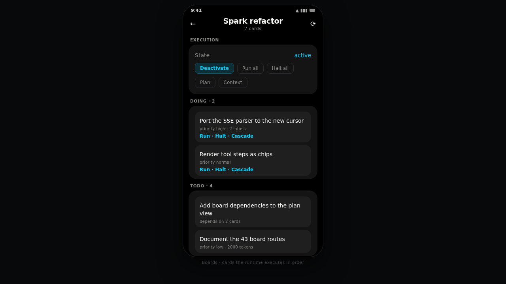
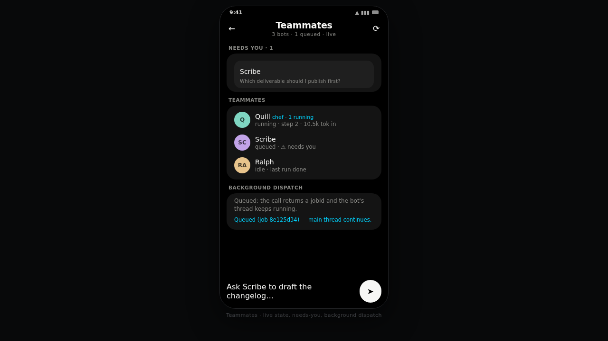

# Mercury Android

An **unofficial Android client for [Mercury Agent](https://github.com/cosmicstack-labs/mercury-agent)**, with an
interface inspired by the Grok app: near-black canvas, one accent colour, big composer, streaming answers,
hold-the-mic dictation, and nothing else in the way.

Not affiliated with Cosmic Stack. It talks to the HTTP API that Mercury's own web dashboard already exposes —
no plugin, no patch, no fork of the agent.

> Status: early. The chat path (login → send → stream → approve) works against Mercury 1.4.2.

## Preview


> **Mockup, not a device capture.** The plate reuses the exact theme tokens
> (`ui/theme/Theme.kt`: palette, type scale, radii) and the real screens' content, but it is drawn
> outside Android: no machine attached to this project can boot an emulator (no `emulator` package
> for linux-aarch64, Robolectric's native runtime refuses aarch64, `redroid` needs `binder_linux`).
> Source: `docs/screenshots/overview.html`. Dropping a real screenshot over the same filename is all
> that is needed to replace it.



*Boards — the kanban the runtime executes card by card (source: `docs/screenshots/boards.html`).*



*Teammates — live state, needs-you block, background dispatch (source: `docs/screenshots/bots.html`).*

## What it does

- **Sign in** to your Mercury instance with the dashboard credentials (session cookie, stored encrypted).
- **Stream** answers token by token over Mercury's SSE feed, with tool steps shown as chips above the reply.
- **Approve** permission requests (`yes` / `always` / `no`) from the phone, instead of walking back to the terminal.
- **Browse sessions** in a drawer, resume any of them with its history, or delete one.
- **Answer everything the runtime blocks on**: tool approvals, loop "keep going?", free-form
  choices and the auto-approval prompt — all through the same permission route.
- **Switch model** from a picker built from `/api/chat/models`, rename entries, and flip
  auto-approval without leaving the phone (réglages).
- **Watch the bill**: daily tokens, remaining budget and the per-channel breakdown.
- **Read its memory**: search what it remembers, add a fact by hand, forget one, confirm or correct
  a belief, restore what the brain set aside — and see the identity/budget the runtime runs with.
- **Dynamic answers.** A message that carries an ` ```openui ` block is drawn as components — table,
  chart, code snippet, cards, stats — instead of source, **and it draws while the answer is still
  arriving**: the block renders the part of the spec that is already complete, so a table appears
  line by line instead of after the last token. The contract is OpenUI Lang v1, enforced
  server-side by the `openui-contract` plugin; a half-written statement is "wait for the next
  chunk", not an error, and a spec this client cannot parse once the fence is closed falls back to
  the fenced code block, never to a half-drawn screen. Needs the daemon to speak the contract (a
  persona instruction is enough): the app renders what it is given and invents nothing.
- **Hand files to a bot.** A photo or a PDF travels with a background dispatch the same way it travels
  with a chat turn — resized on the phone (1600 px, JPEG q80), capped at 4 files, and the file can go
  alone: the server captions the turn itself. Needs the upstream route from
  [mercury-agent#231](https://github.com/cosmicstack-labs/mercury-agent/pull/231); on an older daemon
  the field is absent and the dispatch is a plain message.
- **Hear about a bot that needs you while the app is closed.** Notifications used to stop with the
  process: the roster SSE only lives while the app runs, so a question posed at 3 am waited for you
  to open it. Two things fix that, and the settings say which is on:
  - **Veille en temps réel** (opt-in) — a `dataSync` foreground service keeps the process, and
    therefore the roster stream, alive once the last activity is gone: alerts arrive in seconds,
    run outcomes included. It costs a permanent notification, which is also the honest sign of it
    ("4 équipiers · 2 vous attendent"), with an `Arrêter` action in the shade. Android 14+ refuses
    to start such a service from the background, so a reboot may fall back to the check below until
    the app is opened once.
  - **Vérification périodique** (15/30/60 min, opt-in, offline-safe) — a `WorkManager` pass reads
    `GET /api/bots` and raises the same notification, once per pending question. It reports only
    what is self-evident without a previous roster (`needsYou`), which is why it is the fallback.
- **Deliverables and runs.** A bot's files are openable from the phone: the fleet inbox
  (`GET /api/bots/outputs`) and each bot's folder, with an inline preview (text, image), share, and
  delete. Run detail, dead letters and replay live in the same sheet — a bot that died on a job is
  relaunched without a terminal.
- **Live boards.** The board you open follows `/api/boards/:id/events` instead of waiting for your
  next tap, with a polling fallback and a visible mark when the stream is down. A card attachment
  can be read: text inline, image inline, anything else handed to the system viewer or saved.
- **Diff rendering.** A ` ```diff ` fence is drawn as a unified diff — header with `+N −M`, a sign
  column, tinted lines — classified exactly like the dashboard's `diff-view` plugin, so a review
  reads the same on both clients.
- **Supervise the daemon** from the console tab: state, uptime, loop lag, providers (and their API
  keys, with a test button), bots and their queue, background tasks, schedules, agents, skills
  (install from a URL or the registry, remove, toggle), plugins, MCP servers, workspace root,
  cost and storage per bot, restart and shutdown.
- **Git and music, without a terminal.** The workspace's repository — branch, ahead/behind, staged
  and unstaged files, stage/unstage, commit (message suggestable), push/pull, branch switch, log,
  diff — plus a compact player for the daemon's Spotify transport.
- **Send photos and PDFs** with a turn (up to 4, 8 MB per image, 15 MB per PDF): the picker
  needs no storage permission, an image is downscaled to 1600 px and re-encoded before it
  leaves the phone, and a photo may travel with no caption. The route it needs
  (`attachments[]` on `/api/chat/send`) is
  [merged upstream](https://github.com/cosmicstack-labs/mercury-agent/pull/225) but **not yet in
  an npm release**: 1.4.2 reads `content` only and silently ignores the field, so run Mercury
  from `main` (or a build of it) until the version that ships it is out.
- **Dictate** with the system speech recogniser — the text lands in the composer, never auto-sent.
- **Markdown** rendering for what agents actually emit: fenced code, lists, headings, `inline code`, **bold**, *italic*.

## Requirements

1. Mercury running with the web dashboard enabled:
   ```bash
   MERCURY_WEB_ENABLED=true MERCURY_PORT=6174
   ```
   The dashboard binds `127.0.0.1` only, so the phone needs a route to it. Recommended:
   ```bash
   tailscale serve --bg --https=8443 http://127.0.0.1:6174
   # then use https://<host>.<tailnet>.ts.net:8443 in the app
   ```
   An SSH tunnel from the phone (`adb reverse`, Termux `ssh -L`, …) also works.
2. A dashboard user. `docker exec -it mercury mercury web-reset-password` sets the password;
   the username is in `~/.mercury/web-config.json` (usually `mercury`).

## Pont appareil (device bridge)

The app can expose the phone's own data to Mercury, read-only, over the tailnet —
so the agent on the Spark can answer "what's on my agenda tomorrow?" or "who texted
me?" without any server-side plugin.

Toggle **Pont appareil** in the drawer:

- **Calendrier** (`READ_CALENDAR`) — events, `GET /calendar?from=&to=&limit=`
- **Contacts** (`READ_CONTACTS`) — names, numbers, e-mails, `GET /contacts?q=&limit=`
- **SMS** (`READ_SMS`) — inbox, `GET /sms?limit=&address=`
- **Messages d'apps** — notification access, `GET /messages?limit=` (SMS + notifications,
  the only way to see WhatsApp/Signal/Messenger content: Android has no readable store for them)
- **Statut** — battery, network, timezone, `GET /device/status`
- `GET /health` — liveness probe only, answers `{"ok":true}` (no token, no instance facts);
  the version/device/providers summary is the tokened `GET /device` route

Security model:

- every route except `/health` requires the bearer token (constant-time compare) in
  `Authorization: Bearer …`;
- `?token=` exists because Mercury's `fetch_url` sends no headers, but a token in a URL
  ends up in any relay's logs: once a tailnet interface is up, the query-token path is
  only accepted from tailnet or loopback sources (a plain-LAN daemon cannot use it);
  without a tailnet the bridge stays on the LAN and keeps accepting it so `fetch_url`
  keeps working — that exposure is explicitly unsupported;
- the token is generated on the device, stored in Keystore-backed encrypted prefs, and
  revocable in one tap; if the Keystore is unusable the bridge refuses to start rather
  than serving with a plain-text token;
- the socket binds to the Tailscale address when present, 120 requests/minute cap;
- error bodies are fixed generic strings (no exception text leaves the phone);
- nothing is cached, nothing is written to disk: each request re-reads the provider.

Mercury side: `MERCURY_ALLOW_PRIVATE_FETCH=1` in `mercury.env` (SSRF protection
otherwise blocks private addresses), then copy `mercury-skills/phone-bridge/SKILL.md`
into `~/.mercury/skills/phone-bridge/` and paste the URL + token from the app.

Caveat: `READ_SMS` is a **restricted permission** for Google Play — an app whose core
function is not SMS cannot ship there with it. Sideloading is unaffected. The
notification-based message access has no such restriction.

## Build

JDK 17+ and the Android SDK (compileSdk 35) are required.

```bash
./gradlew testDebugUnitTest   # unit tests only, no device needed
./gradlew assembleDebug       # app/build/outputs/apk/debug/app-debug.apk
```

A prebuilt debug APK is attached to every release and by CI on `main`.

### Building on an ARM64 host (DGX Spark, arm64 VM)

Google ships `aapt2` for **x86_64 only** — no `linux_arm64` classifier exists on Google Maven, so any Android
build on an arm64 host fails with `Exec format error` (this is language-agnostic: `cargo-apk`/`xbuild` for a
Rust UI would hit the same wall). The repo ships a builder image that runs the official `aapt2` under
`qemu-user` inside a container, so nothing changes on the host:

```bash
./scripts/build-arm64.sh                       # :core:test + :app:assembleDebug
./scripts/build-arm64.sh :app:assembleRelease  # any other Gradle task
```

It builds `docker/Dockerfile.builder` (Android SDK 35 + qemu-user + amd64 `libc`/`libstdc++`), then runs Gradle
with `-Pandroid.aapt2FromMavenOverride=/opt/aapt2-qemu/bin/aapt2`. Expect ~20 s once the image and the Gradle
cache are warm.

### Adding a language

The UI ships in French (the base, `values/`) and English (`values-en/`). Adding a third is two steps
and one command:

```bash
./scripts/new-language.sh de "Deutsch"   # copies the base strings into values-de/
```

1. translate the copied files;
2. add one row to the `Languages` registry and list it in `Languages.all`
   (`app/src/main/java/io/github/tournierjc/mercury/device/AppLanguage.kt`).

Nothing else enumerates languages: the settings dropdown, the stored choice and the date formatting
all read that registry. Two tests keep the two halves honest — `StringParityTest` fails when a
language misses a key or carries one the base does not have (or changes a `%1$s`), and
`LanguagesTest` fails when a `values-xx/` folder has no registry row, or a row has no folder.

## How it works

```
core/src/main/kotlin/io/github/tournierjc/mercury/     (JVM, no Android — unit tested)
├── data/MercuryApi.kt        one typed method per Mercury route
├── data/SseParser.kt         SSE framing, chunk-boundary safe
├── data/ChatEvent.kt         every wire event → typed event (unknown types ignored)
├── data/ChatReducer.kt       pure state machine (streaming, steps, interactions)
├── data/SessionCookieJar.kt  persists mercury_session, drops expired cookies
├── data/dto/ChatDto.kt       models, settings, usage, account payloads
├── data/dto/SystemDto.kt     status, health, skills, plugins, work payloads
├── device/DeviceDtos.kt      bridge payloads
└── util/Format.kt            uptime and token formatting
app/src/main/java/io/github/tournierjc/mercury/
├── vm/                       ChatViewModel, SettingsViewModel, ConsoleViewModel
└── ui/                       Compose: Connect, Chat, Composer, InteractionCard, drawer,
                              Réglages, Console, Mémoire, Bridge, MarkdownText
```

### API coverage

Everything below is a route the Mercury 1.4.2 dashboard already serves; the client adds no
server-side code. Payload shapes were captured from a live instance, not guessed — the ones
that are not documented (`bots`, `bg`, `schedules`, `agents`, memories, tree entries) stay
`JsonObject` on purpose, so a schema change shows up as data instead of a crash.

| Area | Routes |
|---|---|
| Auth | `POST /api/auth/login`, `/logout`, `/password`, `/username` |
| Chat | `GET /api/chat/threads`, `/threads/{id}`, `POST /api/chat/send` (with `attachments[]`), `GET /api/chat/events` (SSE), `POST /api/chat/permission/{id}`, `POST /api/chat/threads/{id}/delete` |
| Models | `GET /api/chat/models`, `POST /api/chat/models/switch`, `POST /api/chat/models/prefs` |
| Settings | `GET` + `PUT /api/chat/settings` (`bypassPermissions`, `restrictUser`, `workspace`) |
| Runtime | `GET /api/health`, `/status`, `/usage`, `POST /api/restart` |
| Capabilities | `GET /api/permissions`, `/providers`, `/skills`, `POST /api/skills/{name}/activate|deactivate`, `GET /api/plugins`, `/plugins/health`, `GET /api/code/status`, `POST /api/code/set` |
| Work | `GET /api/bots`, `GET|PATCH|DELETE /api/bots/{id}`, `POST /api/bots`, `/bots/{id}/enable|disable`, `/bots/{id}/start|stop|message|run`, `GET /bots/{id}/journal|runs|outputs`, `GET /bots/tiers`, `POST /bots-start-all|stop-all`, `GET /api/bg`, `POST /api/bg/{id}/cancel`, `/bg/clear`, `GET /api/agents`, `POST /api/agents/halt|stop`, `GET /api/schedules`, `DELETE /api/schedules/{id}` |
| Terminal | `POST /api/terminal/exec` — one shell command in the workspace (30 s, 2 MB), with a second confirmation on destructive patterns |
| Teammates | roster, detail, start/stop/run/enable/disable, create, delete, persona (read/write), permissions (read + tier), model, daily budget, journal, runs, outputs, inbox, delegated tasks, `PATCH /api/bots/:id`, `GET/PUT/DELETE /api/bots/:id/avatar` |
| Fleets | `GET/POST /api/bots/:id/crew`, promote, autocrew, tier changes |
| Boards | all 43 `/api/boards` routes: list/create/patch/delete, activate/deactivate, generate, cards (add/bulk/patch/delete/reorder/clear-done), run/halt/cascade per card, run-all/halt-all, execution-plan, smart-execute, comments, attachments, labels, parent, dependencies, context (directory/instructions/variables/knowledge/structure), feedback + respond |
| Second brain | `GET /api/brain/status`, `/brain/memory` (+ `q`, `type`, `scope`), `GET|PUT|DELETE /brain/memory/{id}`, `POST /api/brain/memory`, `GET /brain/beliefs`, `POST /brain/beliefs/{id}/confirm|correct|forget`, `GET /brain/persons`, `/brain/graph`, `/brain/quarantine`, `POST /brain/quarantine/{id}/restore` |
| Config & workspace | `GET /api/config`, `GET /api/workspace/info`, `/workspace/tree`, `/workspace/file?path=` |

SSE events handled: `connected`, `text_delta`, `text_done`, `thinking`, `step_start`, `step_done`,
`permission_request`, `permission_continue`, `choice_prompt`, `permission_mode`,
`session_switched`, `provider`, `loop_warning`, `error`; `heartbeat` is treated as a keep-alive.

Deliberately **not** wired, and why:

- `terminal/exec`, `git/*`, workspace writes, `restart`-adjacent shell routes — arbitrary code
  execution from a phone is a footgun; the chat tools already cover the same ground under the
  permission prompt.
- Boards (37 routes), plugins install/update, bot creation, schedules create — desktop-shaped
  workflows with large payloads that have no captured contract yet. They would be invented
  schemas, which is exactly what this client refuses to ship.
- `POST /api/shutdown` — returns 403 unless explicitly enabled; a mis-tap would kill the agent.

## Limitations

- Streaming is text-only: no image/artifact rendering yet, no attachments out.
- The SSE flow is not auto-reconnected; a dropped stream surfaces an error and the next send re-opens it.
- Console lists (bots, tasks, schedules, agents) render the fields Mercury sends today; they are
  deliberately untyped, so a richer layout needs a captured sample first.
- Files in the workspace are listed only — no read/write/delete from the phone.
- Nobody has run this on a physical device yet: unit tests and APK builds are green, the UI has
  only been verified through compilation.
- Voice is one-shot dictation via the system recogniser — no streaming speech, no wake word.
- `usesCleartextTraffic` is on so that `http://` tunnels work in development; point it at the HTTPS
  tailnet URL and traffic stays TLS.

## Privacy

The app contacts exactly one host: the Mercury instance you type in. No analytics, no crash reporting, no
third-party SDKs, and the session cookie is stored with `EncryptedSharedPreferences` (Android Keystore).

## License

MIT — see [LICENSE](LICENSE). "Mercury" here refers to the agent; the Grok app is only a visual reference.

## Teammates, live

Every bot can carry a face: a photo sent from the phone with `PUT /api/bots/:id/avatar` (512 px,
re-encoded before it leaves the device, ≤ 2 MB), rendered in the roster and the fleet list. The
monogram is the fallback, and `hasAvatar` means the app never probes an endpoint that has nothing
to return. Against a Mercury that predates the avatar route the fetch answers 404 and nothing
changes — which is why the plate above still shows monograms: none of those bots has a photo set.

The bots are the part of Mercury that keeps working when nothing is typed. The app gives them
a real screen:

- **Roster** with a monogram avatar, live state (`en cours`, `en file`, `en pause`, `désactivé`),
  the current step ("step 2 · 10.5k tok in") and a **needs-you** block at the top.
- **Background dispatch**: a task sent to a bot is *queued*, not awaited — the call answers
  `202 {accepted:true, jobId}` and the bot's own thread is never blocked. A busy or paused bot
  answers `409 {reasonCode}` and the app says so instead of pretending the task was accepted.
- **Customization**: persona (read and rewritten), permission tier, model, daily token budget,
  description, enabled. `PATCH /api/bots/:id` is the only manifest-writing route.
- **Fleets**: promote a bot to lead, inspect its crew with each member's live activity, add a
  member, or let the runtime propose the crew (`autocrew`, 202 + background build).
- **Journal, runs, outputs, inbox, delegated tasks** for each bot.

### Notifications, and their honest limit

`/api/bots/events` streams `bot_roster` (state, activity, `needsYou`) and `bot_activity`
(`step`, `thinking`, `turn-end`, with `reasoningTail`). The app keeps that stream open for the
whole process and raises **one** notification per transition — "X a besoin de vous", "X a
terminé", "X a échoué" — plus passive lines in the roster ("Scribe lit report.md").

Mercury 1.4.2 has **no push transport**: notifications arrive while the app process is alive.
Killing the app stops them. Making them survive would need either a foreground service holding
the SSE stream or a server-side push channel — neither exists today, and the README does not
pretend otherwise.

**Avatars**: there is no avatar field anywhere in the Mercury API (grep returns zero). The app
draws a deterministic monogram whose colour is derived from the bot id, so a bot keeps its
identity across sessions without inventing data.

## Terminal

`POST /api/terminal/exec` runs one command in the workspace from the phone, 30 s timeout, 2 MB
of output, `cwd` confined to the workspace. It is arbitrary code execution on the host, so the
screen asks for a **second confirmation** on destructive patterns (`rm -rf`, `docker rm`,
`git reset --hard`, `shutdown`, …). The denylist is deliberately short: a longer one only
teaches you to click through it.
